<h1 align="center">dyslexic mode</h1>

<p align="center">
  <b>The model thinks the dyslexic way. The answer reads the way you read.</b><br>
  A terminal chat for any model. It thinks in pictures and patterns, and every reply is checked for easy reading.
</p>

<p align="center">
  
</p>

- `/think` changes how the model thinks, before it writes a word.
- Every reply is checked the way a dyslexic reader reads, then fixed once if it fails.
- Any model: Claude, grok, and every model your opencode has.
- ChatGPT voice. You bring your own OpenAI key. It stays in your Keychain.
- Type `!` after a reply that tripped you. It learns a rule from it.
- `/help` lists every command. A typo still works: `/clam` runs `/calm`.

## Thinking modes

`/think` sets how the model thinks.
It is kept for next time. A change starts a fresh chat.

| Level | What the model does |
|-------|---------------------|
| `off` | nothing special |
| `dyslexic` | the whole picture first, details last. It pictures the problem, tries 2 or 3 ways in, finds the pattern, then narrows |
| `strong` | writes five parts first: big picture, a sketch, three ways in, the pattern, and the narrowed answer |
| `extreme` | thinks in sketches and arrows, not sentences. It reads the answer off the picture |
| `explorer` | three drafts at once (picture, pattern, story), then one answer that weighs them |

The first four are text.
They go into the system prompt under `How to think`, before the reply rules.
The model thinks first and lays the answer out last.

The thinking stays out of the reply.
A model that can think in private does.
One that cannot writes it in one fenced block just before the answer.

Explorer is not text. The app runs it.
Each message makes four calls: three drafts at once, then one that weighs them.
It costs four times the calls. It works without tools.
Each call carries the last three turns as text, so it remembers the chat.
The status line says `exploring 3 ways`.

Does it help? [Measure it.](#does-the-thinking-help)

## Run it

```bash
npx github:hangryclaude/dyslexic-mode
```

Or clone it and run `node bin/dyslexic-mode.mjs`.

You need Node 20+ and the `claude` CLI, logged in.
`grok` and `opencode` are optional. Voice needs `ffmpeg`.
There are no packages to install.
Built and tested on macOS. `/copy` uses `pbcopy`, and your key uses the Keychain.

`-c` goes back to your last chat.

## Any model

`/model` opens a list. Up and down move, Enter picks.
`/model opus` types the name. A slip like `/model opsu` works too.
`/model refresh` asks the providers again, and says which one could not be asked.

| Provider | Models | Runs on |
|----------|--------|---------|
| Claude | fable, opus, sonnet, haiku | the `claude` CLI you are logged in to |
| grok | whatever `grok models` lists | the `grok` CLI |
| opencode | every model your opencode has | the `opencode` CLI |

Each one uses its own login. This app holds no key for them.

A model's id says where it goes:
`claude/opus`, `grok/grok-4.7`, `opencode-go/gemini-4-argon`.
A bare `sonnet` still means `claude/sonnet`.

- The list is asked once a day. It is kept in `~/.dyslexic-mode/models.json`.
  That file holds ids, names and window sizes. Nothing from a login.
- A new model starts a fresh session, because a session belongs to the model that began it.
  The chat stays on screen. The choice is kept for next time.
  `--model haiku` is for one launch only.
- Everything follows the model: the chat, `/plan`, `/compact`, `/test` and explorer.
  The one exception is `!`. It learns its rule with Claude Haiku.
- grok and opencode are plain chat, with no tools.
  Full access is Claude's alone. `/tools` will not turn it on for another provider.
- Going back to a chat that another provider began (`-c` or `/resume`) switches to that model.
- `/context` uses each provider's own token counts.
  A model that gives none is said so, and only the system prompt is counted.

## ChatGPT voice

Talk instead of typing. Hear the answer, and read it too.

1. `/key` asks for your OpenAI key. The letters stay hidden.
2. `/voice` starts the voice chat. `/voice` again stops it.

- It uses your own OpenAI key. It costs money on your OpenAI account.
- Wear headphones. With speakers the mic hears the reply and cuts it off.
- You need `ffmpeg` (`brew install ffmpeg`).
  Your terminal must be allowed to use the microphone.
- Both sides show as text: `you said: ...`, then the reply as it is spoken.
- The voice is told to use short sentences, one idea each, in plain words.
- It is its own chat. Typed messages still go to the model you chose with `/model`.
- Each exchange joins the chat, so `/export` and `/copy` have it.
- Quitting, closing the terminal and a normal kill all let the microphone go.

No key yet? `/voice` says:

> ChatGPT voice needs an OpenAI key. Type /key to add it. It is saved in your Mac's Keychain, never in a file.

## Keys and secrets

- Claude, grok and opencode use their own logins. This app never sees those keys.
- Only voice needs a key: your OpenAI key.
- It lives in the macOS Keychain (service `dyslexic-mode`, account `openai`).
  Or set `OPENAI_API_KEY` in your shell. That one is used first.
- `/key` asks with the letters hidden. A key typed after the command is refused.
- The key is never written to a file of ours. It is never printed, and never in a log or a chat.
  An error message shows it as `[key]`.
- It goes to OpenAI in a header, never in an address.
- While it saves, macOS `security` gets the key on its command line for a moment.
- To delete it: open Keychain Access, search `dyslexic-mode`, delete the item.
- This repo ignores `.env`, `.env.*`, `*.pem` and `*.key`.
- `npm test` scans every tracked file for key shapes.
  `npm run check-secrets` runs `gitleaks` if you have it.

## Commands

`/help` shows this list in the app.
Typed commands forgive slips: `/clam` runs `/calm`.
Two commands that start the same way, like `/co`, are never guessed.

| Command | What it does |
|---------|--------------|
| `!` | flags the last reply as hard to read. It learns a rule |
| `/new` | starts a fresh chat |
| `/clear` | the same as `/new` |
| `/resume` | goes back to an old chat |
| `/compact` | shrinks the chat to a summary and carries on from it |
| `/plan <goal>` | turns a goal into a study plan, saves it, prints the path |
| `/plan` | shows your latest plan |
| `/export` | saves the chat as a markdown file, prints the path |
| `/copy` | copies the last reply |
| `/model` | picks any model with the arrow keys. `/model opus` types it |
| `/think` | picks how the model thinks |
| `/context` | shows how full the context window is |
| `/status` | model, thinking, tools, context, session, voice |
| `/tools` | turns full access on or off. Claude only |
| `/test` | runs one round of the blind reading test |
| `/stats` | shows the numbers |
| `/profile` | shows the rules it learned from your flags |
| `/color` | switches to the next color set |
| `/brain` | shows a big spinning 3D brain |
| `/calm` | turns motion off |
| `/pliny` | l33t replies with dividers |
| `/voice` | talks with ChatGPT voice, on or off |
| `/key` | saves your OpenAI key in the Keychain |
| `/help` | every command, grouped |
| `/exit` | quits |

## Keyboard

| Key | What it does |
|-----|--------------|
| Esc | stops a reply while it is being written |
| `/` then Enter | opens the menu. Up and down move, a number jumps, Enter picks |
| `!` | flags the last reply as hard to read |

Keys you type while a reply is coming in wait for the prompt.

## Context

`/context` draws the context window as a bar, then splits it in columns:
the system prompt, the conversation, and what is free.

- The conversation and the total come from what the model reported for the last reply.
- The system prompt is a guess: its characters divided by 4. It is marked `about`.
- The window size is what the model reports after a reply.
  Before that it is the model list's size. Where that is only a guess, like Claude's 200,000, `/context` says so.
  A model id with `[1m]` counts as 1M.
- A size a model reports is kept, so the next launch starts with the right one.

`/compact` asks the chat for a summary of itself,
then starts a fresh session whose first message is that summary.
It shows the tokens before and after.

## Plans and exports

`/plan learn the basics of chess` asks the model for a plan.
It gets one very small first action, under 2 minutes,
then steps of at most 25 minutes each. A longer step is split into equal parts.
You get a checklist with a time box on each line.

A message about studying, an exam, homework or a deadline gets a plan like this without asking.
It has a goal line, a first step under 2 minutes, steps of 25 minutes or less,
a break after every 2, and a checklist.

Plans are saved in `~/.dyslexic-mode/plans/` as `<date>-<topic>.md`.
Chats from `/export` go in `~/.dyslexic-mode/exports/`.
A second file with the same name gets `-2`. Nothing is overwritten.

## How a reply is made

1. The model gets the `dyslexic-reread` skill in its system prompt,
   after the thinking level if you set one.
2. It writes the reply and runs the re-read pass on it.
   Line 1 is the answer, in 12 words or fewer.
   Bullets are 12 words or fewer. A paragraph is 2 short sentences at most.
3. Each line shows as soon as it is complete. Tables wait for their last row.
4. The linter in `skill/scripts/reread.mjs` checks the hard limits.
5. A hard hit gets one rewrite. Never two.
   It takes the draft's place on screen.

One process or session runs for the whole chat.
So a message has no start-up wait.
In full access, your tool servers stay up between messages too.

## The screen

- Lines are at most 72 characters. `--width 60` makes them shorter.
- Tables are drawn as boxes. Numbers line up on the right.
- A table too wide for the line wraps inside its cells.
- Headings get a colored bar. Code gets a bar down its side.
- Italics are shown upright, because italics read worse.

## Full access

It starts as a plain chat. The model has no tools.

`--full` or `/tools` gives Claude full access.
Then the chat can use files, the shell, the web, your skills,
Claude agents and Codex.

Full access skips Claude's permission prompts.
Only turn it on if you trust what you ask it to do.

It loads your own Claude Code settings, so your guard hooks still run.
In a test, a guard hook blocked `git reset --hard` inside the chat.
The status line shows each tool call while it runs.

Full access is Claude's alone.
A model from another provider turns it off, and `--full` is dropped with a note.

## Colors

Each launch picks a color set at random.
There are 7: neon, fire, ocean, toxic, sunset, candy, aurora.

`/color` steps to the next one. `--palette fire` picks one at launch.

## How it learns

1. Type `!` after a reply that tripped you. Add a note if you like.
2. Claude Haiku turns that into one rule in your profile.
3. Your profile goes into every prompt after that.

Your data stays in `~/.dyslexic-mode/`, not in this repo.
That folder holds your chats, flags, test rounds, profile, settings, plans, exports and the model list.

## The reading test

Each `/test` round asks one question and gets two answers.
One is plain. One is the re-read version.

You read them in random order and press Enter when done.
Then you pick the easier one.
After 10 rounds, `/stats` has the answer.

Other flags: `--model haiku`, `--pliny`, `--calm`.

Pliny mode is for fun. It is off by default,
because swapped letters are harder to decode.
Code, paths and links stay untouched in Pliny mode.

## Does the thinking help?

Find out. `bench/` asks the same questions under each style and counts the right answers.

- Questions with one right answer, made from a seed: `walk`, `dice`, `pattern`, `arith`, `letters`, `trick`.
- Creative uses (`uses`) has no key. Two judges from different families rank the lists, blind.
- Ways to ask: `base`, `careful`, `dyslexic`, `strong`, `extreme`,
  `scrambled` (the question as a dyslexic reader sees it), `explorer`,
  `vote3` (three plain answers and a vote, the same cost as explorer),
  `picture` and `whiteboard` (a model draws the question, then answers from the picture).
- `careful` is the control: a step-by-step style as long as `dyslexic`.
  A win for `dyslexic` over `careful` means the style helped, not just any extra words.
- Models: `claude:opus`, `grok`, `opencode:<provider/model>`.

```bash
node bench/run.mjs --dry --models claude:opus --conds base,careful,dyslexic,strong
node bench/run.mjs --models claude:opus --conds base,careful,dyslexic,strong \
  --families walk,dice,pattern,arith,letters,trick --per 8 --out bench/results/run1.jsonl
node bench/report.mjs --in bench/results/run1.jsonl --md bench/RESULTS.md
```

Every job is a real call on your subscription. `--dry` counts them first.
Stop a run any time and start it again. Finished jobs are skipped.

A strong model may already get most standard questions right.
Then no style can show a gain.
`--scale 4` makes `walk`, `dice`, `arith` and `letters` four times as long.
Run `base` alone first to see where the model stands.

`bench/evolve.mjs` improves a style for one model.
Then it checks the winner on questions the loop never saw.

```bash
node bench/evolve.mjs --model claude:opus --proposer claude:opus --rounds 4 --variants 3 \
  --train 4 --holdout 8 --start strong --out bench/results/evolve.jsonl
```

The report says `clearly better` only with 6 or more disagreeing pairs and p under 0.05.
Otherwise it says `no clear difference` or `too few to tell`.

The pilots in `bench/results/` are tiny.
They show the plumbing works. They do not show that thinking helps.

## The brain

<p align="center">
  
</p>

The brain is ray-marched in 3D for every terminal cell.
Each lobe gets its own color, like an anatomy chart.
It spins in the intro.

Just the brain: `npm run brain`. Any key quits.

The two pictures in this file are real recordings of the app.
`tools/capture.mjs` makes them from tmux. No recorder needed.

## Test

```bash
npm test
```

The tests use fake `claude`, `grok`, `opencode`, `pbcopy`, `security`, `ffmpeg` and `ffplay`, and a fake OpenAI socket.
So they make no real calls, never touch your clipboard or your Keychain,
and never open the microphone.

The opencode integration tests run against the real `opencode` only on request:
`DYSLEXIC_INTEGRATION=1 npm test`. They add chats to your own opencode database.

## The skill

`skill/` is a copy of `~/.claude/skills/dyslexic-reread`.
It holds the research, rewrite patterns, evals and the linter.
