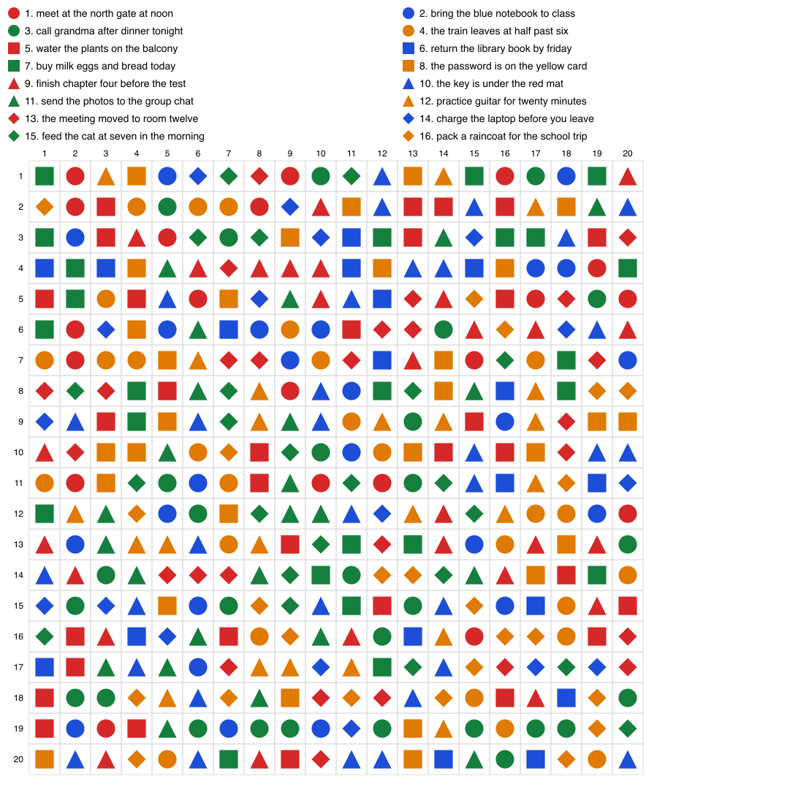

# How much fits in one image?

Measured 2026-11-03 with `bench/tiles.mjs` on Claude Haiku 5.5 and Opus 5.5.
Most tests ask for 12 items back, so one miss is about 8 points.
Each test ran once. Treat small gaps as noise.

## What an image costs

- About 1 token per 750 pixels.
- It tops out near 4,900 tokens, at about 1,920 × 1,920. A bigger image is shrunk first.
- Haiku and Opus charge the same.

## What one image holds (Opus 5.5)

| Test | Held | Read right | Tokens in |
|---|---:|---:|---:|
| small text, 16 px | 306 codes | 12/12 | 2,275 |
| small text, 6 px | 2,192 codes | 0/12 | 2,279 |
| 25 puzzles in a grid | 25 puzzles | 21/25 | 91 per puzzle |
| the same 25 puzzles as text | 25 puzzles | 25/25 | 64 per puzzle |
| duck-rabbit: codes + faint hidden letters | 306 codes + 6 letters | 12/12, letters not seen | 2,340 |
| duck-rabbit: codes + darker hidden letters | 306 codes + 6 letters | 0/12, letters wrong | 2,339 |
| 1 colour layer + a key | 294 codes | 11/12 | 2,303 |
| 2 colour layers + a key | 588 codes | 7/12 | 2,300 |
| 3 colour layers + a key | 882 codes | 0/12 | 2,306 |
| **400 sentences as shapes + a key** | **400 sentences** | **12/12** | **2,378** |
| the same, every sentence written out | 400 sentences | 12/12 | 8,485 |
| the same, as numbers + the key, in text | 400 sentences | 12/12 | 1,735 |

Haiku 5.5 on the same shapes image: 12/12 on one run, 0/12 on another.
Its text answers were 12/12 both times. One run is not enough to trust one score.



## What it means

- A bigger image does not hold more. Smaller writing does, until the model cannot read it.
- Text in an image is safe at about 2× cheaper (16 px). Below that, mistakes start.
- Two pictures in one fail. A faint layer is invisible. A strong one ruins the other layer.
- Colour layers fail the same way. The pixels are already full.
- A key saves the most. One shape stood for a whole sentence: 3.6× fewer tokens than the text.
- The same key in plain text was cheaper still. The key does the work, not the picture.
- A key only helps when things repeat. If every item is different, there is nothing to shorten.

## Raw output

### cost-haiku

```text
┌─────────┬─────────────┬────────────┬─────────────┬─────────┐
│ (index) │ size        │ megapixels │ imageTokens │ formula │
├─────────┼─────────────┼────────────┼─────────────┼─────────┤
│ 0       │ '400x400'   │ 0.16       │ 341         │ 213     │
│ 1       │ '800x800'   │ 0.64       │ 956         │ 853     │
│ 2       │ '1092x1092' │ 1.19       │ 1636        │ 1590    │
│ 3       │ '1568x1568' │ 2.46       │ 3250        │ 3278    │
│ 4       │ '2000x2000' │ 4          │ 4911        │ 5333    │
│ 5       │ '3000x3000' │ 9          │ 4914        │ 12000   │
│ 6       │ '4000x1000' │ 4          │ 2270        │ 5333    │
└─────────┴─────────────┴────────────┴─────────────┴─────────┘
```

### cost-opus

```text
┌─────────┬─────────────┬────────────┬─────────────┬─────────┐
│ (index) │ size        │ megapixels │ imageTokens │ formula │
├─────────┼─────────────┼────────────┼─────────────┼─────────┤
│ 0       │ '400x400'   │ 0.16       │ 331         │ 213     │
│ 1       │ '800x800'   │ 0.64       │ 951         │ 853     │
│ 2       │ '1092x1092' │ 1.19       │ 1632        │ 1590    │
│ 3       │ '1568x1568' │ 2.46       │ 3248        │ 3278    │
│ 4       │ '2000x2000' │ 4          │ 4916        │ 5333    │
│ 5       │ '3000x3000' │ 9          │ 4913        │ 12000   │
│ 6       │ '4000x1000' │ 4          │ 2268        │ 5333    │
└─────────┴─────────────┴────────────┴─────────────┴─────────┘
```

### density-haiku

```text
┌─────────┬──────┬───────┬─────────────┬──────────┬──────────────┬───────────┬─────────┐
│ (index) │ font │ facts │ imgTokensIn │ imgRight │ textTokensIn │ textRight │ saving  │
├─────────┼──────┼───────┼─────────────┼──────────┼──────────────┼───────────┼─────────┤
│ 0       │ 16   │ 306   │ 2297        │ '11/12'  │ 4371         │ '12/12'   │ '1.9x'  │
│ 1       │ 12   │ 544   │ 2300        │ '8/12'   │ 7277         │ '12/12'   │ '3.2x'  │
│ 2       │ 10   │ 738   │ 2295        │ '3/12'   │ 9624         │ '12/12'   │ '4.2x'  │
│ 3       │ 8    │ 1236  │ 2298        │ '0/12'   │ 15935        │ '12/12'   │ '6.9x'  │
│ 4       │ 6    │ 2192  │ 2306        │ '0/12'   │ 28496        │ '11/12'   │ '12.4x' │
└─────────┴──────┴───────┴─────────────┴──────────┴──────────────┴───────────┴─────────┘
```

### density-opus

```text
┌─────────┬──────┬───────┬─────────────┬──────────┬──────────────┬───────────┬─────────┐
│ (index) │ font │ facts │ imgTokensIn │ imgRight │ textTokensIn │ textRight │ saving  │
├─────────┼──────┼───────┼─────────────┼──────────┼──────────────┼───────────┼─────────┤
│ 0       │ 16   │ 306   │ 2275        │ '12/12'  │ 4346         │ '12/12'   │ '1.9x'  │
│ 1       │ 12   │ 544   │ 2276        │ '10/12'  │ 7252         │ '12/12'   │ '3.2x'  │
│ 2       │ 10   │ 738   │ 2273        │ '10/12'  │ 9599         │ '12/12'   │ '4.2x'  │
│ 3       │ 8    │ 1236  │ 2271        │ '4/12'   │ 15910        │ '12/12'   │ '7.0x'  │
│ 4       │ 6    │ 2192  │ 2279        │ '0/12'   │ 28471        │ '12/12'   │ '12.5x' │
└─────────┴──────┴───────┴─────────────┴──────────┴──────────────┴───────────┴─────────┘
```

### mosaic-haiku

```text
┌─────────┬─────────┬─────────────┬──────────┬──────────────┬──────────────┬───────────┬───────────────┐
│ (index) │ puzzles │ imgTokensIn │ imgRight │ imgPerPuzzle │ textTokensIn │ textRight │ textPerPuzzle │
├─────────┼─────────┼─────────────┼──────────┼──────────────┼──────────────┼───────────┼───────────────┤
│ 0       │ 1       │ 2304        │ '0/1'    │ 2304         │ 695          │ '1/1'     │ 695           │
│ 1       │ 4       │ 2309        │ '2/4'    │ 577          │ 812          │ '4/4'     │ 203           │
│ 2       │ 9       │ 2285        │ '7/9'    │ 254          │ 1007         │ '9/9'     │ 112           │
│ 3       │ 16      │ 2304        │ '11/16'  │ 144          │ 1280         │ '16/16'   │ 80            │
│ 4       │ 25      │ 2310        │ '17/25'  │ 92           │ 1631         │ '25/25'   │ 65            │
└─────────┴─────────┴─────────────┴──────────┴──────────────┴──────────────┴───────────┴───────────────┘
```

### mosaic-opus

```text
┌─────────┬─────────┬─────────────┬──────────┬──────────────┬──────────────┬───────────┬───────────────┐
│ (index) │ puzzles │ imgTokensIn │ imgRight │ imgPerPuzzle │ textTokensIn │ textRight │ textPerPuzzle │
├─────────┼─────────┼─────────────┼──────────┼──────────────┼──────────────┼───────────┼───────────────┤
│ 0       │ 1       │ 2280        │ '1/1'    │ 2280         │ 670          │ '1/1'     │ 670           │
│ 1       │ 4       │ 2279        │ '3/4'    │ 570          │ 787          │ '4/4'     │ 197           │
│ 2       │ 9       │ 2283        │ '6/9'    │ 254          │ 982          │ '9/9'     │ 109           │
│ 3       │ 16      │ 2285        │ '13/16'  │ 143          │ 1255         │ '16/16'   │ 78            │
│ 4       │ 25      │ 2281        │ '21/25'  │ 91           │ 1606         │ '25/25'   │ 64            │
└─────────┴─────────┴─────────────┴──────────┴──────────────┴──────────────┴───────────┴───────────────┘
```

### layers-opus

```text
┌─────────┬────────┬──────────────┬─────────┬──────────┬───────────────┐
│ (index) │ layers │ codesInImage │ right   │ tokensIn │ tokensPerCode │
├─────────┼────────┼──────────────┼─────────┼──────────┼───────────────┤
│ 0       │ 1      │ 294          │ '11/12' │ 2303     │ 7.8           │
│ 1       │ 2      │ 588          │ '7/12'  │ 2300     │ 3.9           │
│ 2       │ 3      │ 882          │ '0/12'  │ 2306     │ 2.6           │
└─────────┴────────┴──────────────┴─────────┴──────────┴───────────────┘
```
